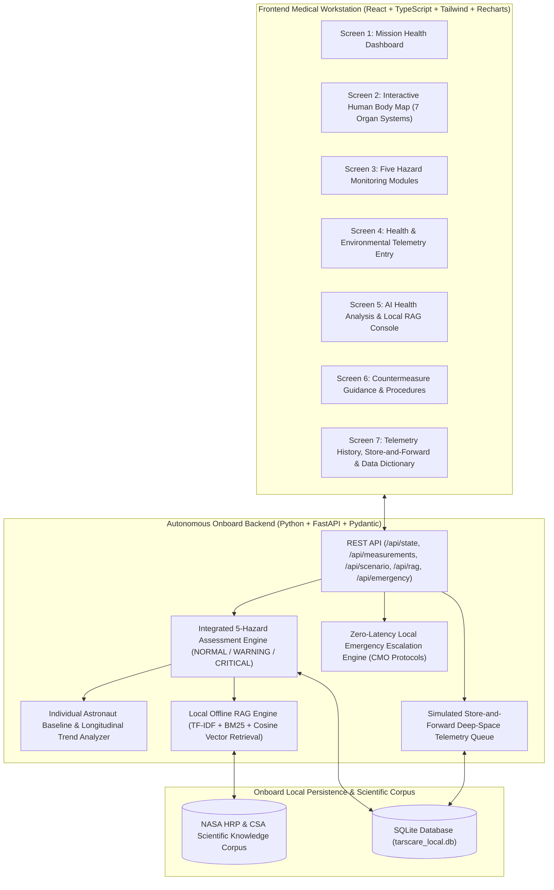

# TARSCARE AI — Autonomous Astronaut Health Monitoring and Decision Support System
**NASA Space Apps Challenge 2026 · Team Milky Has Its Own Way**

TARSCARE AI is an offline-first, autonomous bio-astronautics health monitoring and medical decision-support web application designed for long-duration deep-space missions, particularly missions to Mars. It enables astronauts to independently monitor their physical and psychological health, compare readings against their personal baselines across different gravitational environments (`0g`, `0.38g`, `1.0g`), evaluate risks across NASA's five human-spaceflight hazards, retrieve evidence-informed medical guidance via local Retrieval-Augmented Generation (RAG) over NASA and Canadian Space Agency (CSA) research literature, and execute store-and-forward telemetry synchronization or zero-latency emergency protocols when Earth communication is delayed or unavailable.

---

## 1. System Architecture Diagram



---

## 2. Quick-Start Installation & Execution Instructions

### Prerequisites
- **Python 3.10+** (with `fastapi`, `uvicorn`, `pydantic`)
- **Node.js 18+** and `npm`

### Step 1: Start the Local FastAPI Backend (Port `8000`)
```powershell
cd backend
pip install -r requirements.txt
python -m uvicorn main:app --host 127.0.0.1 --port 8000
```
On startup, the backend automatically initializes `backend/tarscare_local.db` with 14 Sols of synthetic Mars mission telemetry (Sol 171–184) and indexes the local NASA/CSA scientific corpus for offline RAG retrieval.

### Step 2: Start the React Frontend Workstation (Port `5173`)
Open a second terminal:
```powershell
cd frontend
npm install
npm run dev
```
Open **http://localhost:5173** in your browser. Vite automatically proxies `/api/*` requests to `http://127.0.0.1:8000`.

---

## 3. Core Functionalities & Seven Main Screens

1. **Screen 1 – Mission Health Dashboard**: Displays astronaut profile (`Cmdr. Elena Vance-Chen`), Mission Day (Sol), active gravity regime, overall risk classification (`NORMAL`, `WARNING`, `CRITICAL`), 5-hazard status matrix, active alerts, personal baseline comparison table, anatomical system summary, and 14-Sol historical trend charts.
2. **Screen 2 – Interactive Human Body Map**: Interactive anterior anatomical telemetry schematic with clickable organ systems (**Brain & CNS**, **Eyes / SANS**, **Heart & Cardiovascular**, **Lungs & Pulmonary**, **Skeletal Muscles**, **Bones**, and **Vestibular & Sensorimotor**), mapping each region to its baseline deltas, spaceflight hazards, and countermeasures.
3. **Screen 3 – Five Hazard Monitoring**:
   - **Module 1 – Space Radiation**: Tracks absorbed physical dose (`mGy`, `mGy/hr`), biologically weighted equivalent/effective dose (`mSv`, `mSv/day`), cumulative mission dose (`mSv`), GCR vs. SPE event timeline, configurable prototype thresholds, and explicit NASA RDP (ARMAS) provenance boundaries.
   - **Module 2 – Isolation and Confinement**: Tracks sleep duration, sleep quality, awakenings, schedule windows, mood, stress, fatigue, workload, crew cohesion, and an interactive **Self-Assessment Questionnaire & Reflective Journal** with non-diagnostic behavioural guidance.
   - **Module 3 – Distance from Earth & Autonomous Medical Support**: Simulates one-way light-time delays (`14.2 min` nominal Mars link, `21.8 min` max range, or `Solar Conjunction Blackout`), local Store-and-Forward report queueing, simulated DSN synchronization, and zero-latency local emergency escalation.
   - **Module 4 – Gravity Fields & Physiological Adaptation**: Monitors transitions across Microgravity (`0g`), Martian surface partial gravity (`0.38g`), and Earth return (`1.0g`), tracking cardiovascular orthostatic intolerance (CSA CCISS / CARDIOBREATH), muscle strength, ARED exercise adherence, balance, and SANS ocular symptoms.
   - **Module 5 – Hostile and Closed Environments**: Monitors spacecraft ECLSS cabin temperature, pressure, O2%, CO2 (`mmHg` and `ppm`), relative humidity, and particulate AQI alongside crew body temperature, SpO2, and respiratory symptoms, correlating CO2 pockets and low humidity with symptoms without auto-diagnosing infections.
4. **Screen 4 – Health Assessment Input**: Allows astronauts to log numeric vitals, dosimetry, sleep/mood ratings, gravity phase, and symptom checklists, or test preset nominal/warning/critical scenarios.
5. **Screen 5 – AI Health Analysis & Local RAG**: Displays detected deviations, personal baseline comparisons, and an interactive **Offline NASA/CSA RAG Query Console** returning synthesized explanations with exact document citations and relevance scores.
6. **Screen 6 – Health Guidance & Recommendations**: Lists prioritized preventive actions, procedure codes (`PROC-RAD-SPE-01`, `PROC-ISO-CIRC-02`, `PROC-GRAV-ORTHO-01`, `PROC-ENV-VENT-02`), interactive completion tracking, and three-tier escalation guidelines.
7. **Screen 7 – Health History, Store-and-Forward Reports & Data Dictionary**: Full longitudinal telemetry log, store-and-forward report synchronization table, and complete data dictionary.

---

## 4. Data Dictionary (Indicators, Units & Sources)

| Indicator | Physical Units | Source / Instrument | Provenance Tag | Scientific & Operational Description |
|---|---|---|---|---|
| **Absorbed Radiation Dose** | `mGy` (milliGray), `mGy/hr` | Crew Active Dosimeter / Habitat TEPC | `SYNTHETIC_DEMO` / `USER_ENTERED` | Physical ionizing energy deposited per unit mass ($1\text{ Gy} = 1\text{ J/kg}$). Strictly distinguished from biologically weighted Sievert. |
| **Equivalent / Effective Dose** | `mSv` (milliSievert), `mSv/day` | Quality-Factor Weighted Dosimetry | `SYNTHETIC_DEMO` / `USER_ENTERED` | Biologically weighted dose accounting for radiation quality factor ($Q$) of GCR heavy ions and SPE protons. |
| **NASA RDP / ARMAS Context** | Reference Schema | NASA Radiation Data Portal (ARMAS) | `REAL_RESEARCH_REF` | Earth high-altitude/aircraft radiation measurements used for dosimetric metadata context; **not** represented as direct Mars surface data. |
| **Heart Rate & Blood Pressure** | `bpm`, `mmHg` (Systolic/Diastolic) | Onboard Cuff / Bio-Monitor | `SYNTHETIC_DEMO` / `USER_ENTERED` | Compared against personal baseline (`58 bpm`, `112/71 mmHg`) across `0g`, `0.38g`, and `1.0g` per CSA CCISS & CARDIOBREATH research. |
| **Oxygen Saturation & Body Temp** | `%` ($\text{SpO}_2$), `°C` | Pulse Oximeter & Tympanic Sensor | `SYNTHETIC_DEMO` / `USER_ENTERED` | Baseline comparison (`98.5%`, `36.6°C`) correlated with cabin $\text{O}_2/\text{CO}_2$ and respiratory symptoms. |
| **Sleep & Behavioural Metrics** | `hrs/sol`, `%` quality, `1–10` scale | Actigraphy & Crew Self-Assessment | `SYNTHETIC_DEMO` / `USER_ENTERED` | Tracks circadian alignment, mood, stress, fatigue, and workload relative to personal baseline without psychiatric diagnosis. |
| **Musculoskeletal & Sensorimotor** | Strength Index, `%` adherence, `/100` balance | ARED Telemetry & Posture Assessment | `SYNTHETIC_DEMO` / `USER_ENTERED` | Tracks antigravity muscle conditioning, bone loading adherence, and neurovestibular balance across gravity transitions. |
| **Cabin Atmosphere (ECLSS)** | `°C`, `kPa`, `%` $\text{O}_2$, `mmHg` / `ppm` $\text{CO}_2$, `%` RH, `AQI` | Spacecraft ECLSS Sensors | `SIMULATED_ENV` / `SYNTHETIC_DEMO` | Tracks closed-habitat life-support parameters and correlates $\text{CO}_2$ pockets or dust with symptoms without auto-diagnosing infections. |

---

## 5. Data Provenance & Transparency

Every record and citation in TARSCARE AI carries an explicit provenance classification:
- `REAL_RESEARCH_REF`: Authentic scientific literature from NASA Human Research Program (HRP), Canadian Space Agency (CSA 2026 radiation monitoring, CCISS, CARDIOBREATH), NASA C-STARS, and NASA Radiation Data Portal (ARMAS context) stored in `backend/knowledge_base.py`.
- `SYNTHETIC_DEMO`: Realistic 14-Sol demonstration telemetry generated for `Cmdr. Elena Vance-Chen` during the Ares-Horizon IV Mars mission (`backend/database.py`). Never presented as actual clinical astronaut medical records.
- `SIMULATED_ENV`: Simulated spacecraft ECLSS atmospheric and radiation storm scenario telemetry.
- `USER_ENTERED`: Measurements, symptom checklists, and psychological questionnaires submitted interactively by the user during the session.

---

## 6. Known Limitations & Medical Safety Disclaimers

1. **Prototype Decision Support Only (Not Clinically Validated)**: All assessment rules, baseline deviation percentages, radiation thresholds, and ECLSS environmental limits are research-informed, configurable prototype rules designed for the NASA Space Apps Challenge 2026 hackathon demonstration. They are **not** clinically validated medical diagnostic criteria.
2. **Non-Diagnostic Guardrails**: Neither the rule-based assessment engine nor the RAG system diagnoses clinical diseases, psychiatric conditions (such as depression or anxiety), or infectious diseases from environmental sensors, nor do they prescribe unverified medications.
3. **ARMAS / NASA RDP Scope**: The NASA Radiation Data Portal (ARMAS) characterizes Earth's upper-atmospheric and aviation radiation environment and is not a direct dataset of Martian surface radiation.
4. **Simulated Store-and-Forward Link**: Module 3 demonstrates an offline-first store-and-forward telemetry queue using local SQLite persistence and does not implement NASA's actual Deep Space Network (DSN) RF protocol stack.
