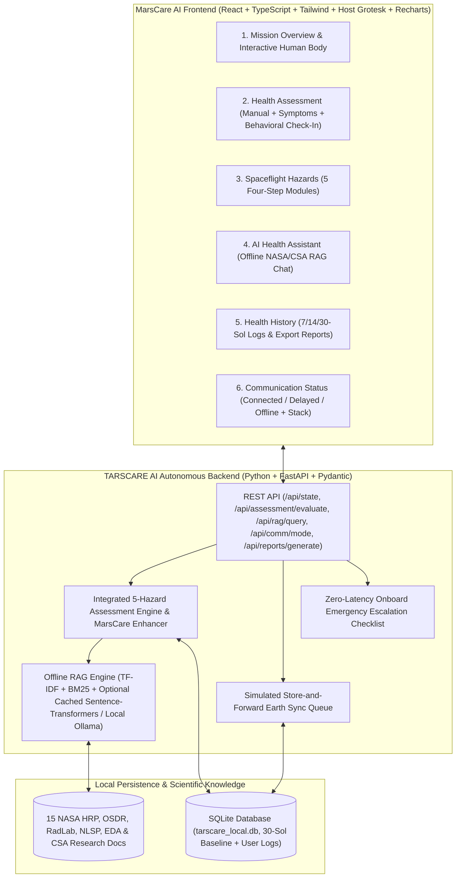

# MarsCare AI — Your Personal Health Companion in Deep Space
**NASA Space Apps Challenge 2026 · Team Milky Has Its Own Way** *(Powered autonomously by the TARSCARE AI backend engine)*

**MarsCare AI** is a calm, offline-first autonomous health-monitoring and self-assessment web application designed for astronauts on long-duration deep-space missions, particularly Mars missions. Built atop the preserved **TARSCARE AI** FastAPI + SQLite + local RAG backend (`backend/`, `tarscare_local.db`, `/api/*`), MarsCare AI enables astronauts to answer three urgent questions at a glance — **How am I doing?**, **What has changed?**, and **Should I take any action?** — explore their body systems interactively, monitor NASA's five human-spaceflight hazards, run self-assessments with dual manual/symptom entry, and consult offline NASA & CSA research without relying on Earth connectivity.

---

## 1. System Architecture



---

## 2. Quick-Start Installation & How to Run

### Prerequisites
- **Python 3.10+** (`fastapi`, `uvicorn`, `pydantic`, plus optional local `sentence-transformers` or local `ollama` if available)
- **Node.js 18+** and `npm`

### Step 1: Start the Local Backend Server (`http://127.0.0.1:8000`)
```powershell
cd backend
pip install -r requirements.txt
python -m uvicorn main:app --host 127.0.0.1 --port 8000
```
On startup, `backend/database.py` initializes `backend/tarscare_local.db` with 30 Sols of realistic synthetic Mars mission telemetry (`Sol 155–184`) and indexes 15 pre-bundled NASA/CSA research documents.
- **Offline Semantic RAG & Optional Local Ollama:** `backend/local_ai_rag.py` auto-detects locally cached HuggingFace `all-MiniLM-L6-v2` weights (`HF_HUB_OFFLINE=1` — zero network requests, background warmup) and probes `127.0.0.1:11434` for Ollama, falling back seamlessly to deterministic TF-IDF + BM25 synthesis whenever either is unavailable.

### Step 2: Start the MarsCare AI Frontend (`http://127.0.0.1:5173`)
In a second terminal:
```powershell
cd frontend
npm install
npm run dev -- --host 127.0.0.1 --port 5173
```
Open **http://localhost:5173** in your browser. Vite proxies `/api/*` requests to `http://127.0.0.1:8000`.

---

## 3. Six Core Navigation Views

1. **Mission Overview** — Opens immediately with a **3-question crew wayfinding triage band** (*How am I doing?*, *What has changed?*, *Should I take any action?*), the centered **Interactive Human Body** (`Head and Brain`, `Eyes`, `Heart`, `Lungs`, `Muscles`, `Bones`, `Whole Body`) with 7-Sol sparklines and baseline comparisons, **Vital Signs vs. Personal Baseline** (`BPM`, `mmHg`, `SpO₂`, `°C`, sleep, mood/stress), **Five Spaceflight Hazard** cards, interactive **7 / 14 / 30-Sol Health Trends**, and **Important Alerts & Actions**.
2. **Health Assessment** — Dual-method onboarding: **Method 1** manual metric inputs (`Heart Rate`, `BP`, `SpO₂`, `Resp. Rate`, `Temp`, `Sleep`, `Mood`, `Stress`, `Absorbed Dose mGy`, `Equivalent Rate mSv/d`, `Cabin CO₂`) across `1g`, `0g`, and `0.38g`, plus **Method 2** body-system symptom pills and an optional private **Behavioral & Sleep Check-In**. Produces a 5-part structured explanation (`What was detected`, `Contributing measurements`, `Associated factors`, `Relevant hazard`, `Recommended next steps`) and **4-tier Health Guidance** (`Immediate action`, `Preventive action`, `Further assessment`, `Medical escalation`).
3. **Spaceflight Hazards** — Detailed modules for **Space Radiation**, **Isolation & Confinement**, **Distance from Earth**, **Gravity Fields** (with `1g` / `0g` / `0.38g` explorer), and **Hostile and Closed Environments**. Each follows four consistent steps (*1. What are we monitoring?*, *2. What has changed?*, *3. Why does it matter in space?*, *4. What should I do next?*) plus live configured warning threshold controls.
4. **AI Health Assistant** — Offline-first companion chatbot backed by `/api/rag/query`, suggested astronaut prompts, real scientific source library drawer (`NASA-HRP-*`, `NASA-RDP-ARMAS-01`, `NASA-RADLAB-01`, `NASA-OSDR-01`, `NASA-LSP-01`, `NASA-EDA-01`, `CSA-TBONE-01`, `CSA-VASCULAR-01`), and automatic medication-prescribing refusal safeguards.
5. **Health History** — Filter longitudinal logs (`7d` / `14d` / `30d`, `All Data` / `Simulated` / `User-Entered`), inspect historical alert flags, generate queued autonomous health summary reports (`POST /api/reports/generate`), and export Markdown reports locally.
6. **Communication Status** — Switch between **Connected**, **Delayed (Mars Nominal)**, and **Offline (Blackout)** via `/api/comm/mode`, monitor the simulated Store-and-Forward deep-space telemetry queue, launch the zero-latency Emergency Escalation Checklist, and inspect live Offline Stack diagnostics (`/api/ai/status`).

---

## 4. Scientific Accuracy, Provenance & Medical Safety Guardrails

- **Radiation Unit Separation:** Always preserves and separates physical **absorbed dose (`Gy` / `mGy`)** from biologically weighted **equivalent/effective dose (`Sv` / `mSv`)**; never invents NASA-approved flight limits (user-configurable alert thresholds are explicitly labeled non-NASA prototype defaults).
- **NASA RDP / ARMAS Context:** Explicitly states that the NASA Radiation Data Portal (ARMAS) represents Earth high-altitude aircraft measurements, not direct Martian surface dosimetry.
- **Non-Diagnostic & Non-Prescribing:** Tracks mood, stress, sleep, and cabin environment trends without automatically diagnosing depression/anxiety or infections, and refuses medication prescription requests while directing crew to Flight Surgeon / CMO checklists.
- **Explicit Data Provenance:** Distinguishes `Simulated Data`, `User-Entered Data`, `Simulated Env`, and `Real Research Data` throughout UI, SQLite persistence, and exported reports.
